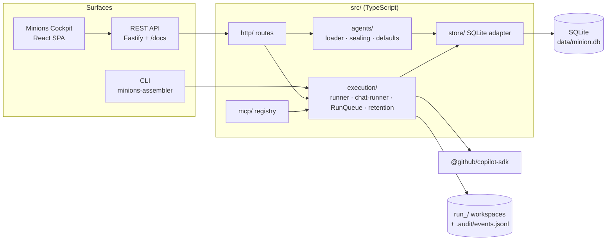

# Minions Assembler

Define, run, audit, and serve **custom GitHub Copilot agents** from a single versioned JSON file.

One JSON definition drives three surfaces:

| Mode | Command | What you get |
|---|---|---|
| **CLI (autonomous / CI)** | `minions-assembler run --agentDefinition ./my-agent.json` | Headless one-shot runs with exit codes for pipelines |
| **Serve (API + Swagger)** | `minions-assembler serve --port 3100` | REST API, `/docs` Swagger UI, OpenAPI JSON |
| **Serve (UI)** | browser at `http://127.0.0.1:3100` | **Minions Cockpit** — Chat (with agent picker) · Agents · Runs · New run · Dashboard · Audit & logs · MCP Registry · Settings · API Docs |

Everything persists to SQLite (`agents`, `runs`, `events`, `usage`, `transcripts`, `mcp_servers`, `sessions`, `credentials`, `chat_threads`, `chat_messages`, `providers`, `projects`, `settings`, `approvals`, `metrics_daily`) for reusability, auditing, and traceability — plus structured JSONL audit logs and per-run event files on disk. Built on [`@github/copilot-sdk`](https://docs.github.com/en/copilot/how-tos/copilot-sdk) (TypeScript / Node.js 18+).

## What you get

- **Chat-first agent platform** — pick a project folder, pick an agent (built-in **GitHub Copilot default** or any custom agent), and chat. Streaming markdown responses, per-turn reasoning/tool streams, approval prompts, cancel mid-turn, transcript export.
- **Custom agents as versioned JSON** — one `AgentDefinition v1.0` file (identity, model/provider, instructions, tools & permissions, MCP, knowledge/workspace, runtime) drives all three surfaces. Advanced users edit JSON directly; everyone else uses the Agents wizard (drafts, AI-aided **Elaborate**, template upload, `.agent.md` import).
- **BYOK providers** — OpenAI, Anthropic, Azure, OpenRouter, Ollama or any OpenAI-compatible endpoint. Keys are sealed AES-256-GCM (`enc:v1:`) in the SQLite vault and never returned by the API; definitions reference keys by `provider-ref`, `${ENV_VAR}` or sealed token.
- **Headless runs for CI** — `run` command and `POST /api/agents/:id/runs` / `POST /api/agent-definitions/runs` execute the same runner as chat turns: queued, stoppable, timed out, exit-coded.
- **Full auditability** — every run (headless **or** chat turn) is a numbered `run_<id>` with `sessionId`/`traceId`/`definition_hash`, a complete ordered event chain (prompt → deltas → tool calls → permission decisions → usage), dual-written to SQLite and per-run `events.jsonl`.
- **Retention you control** — chat/run history is kept **7 days by default**, configurable 0–3650 days (`Settings → Data & retention` or `PATCH /api/settings`), with pinned-item protection and daily metrics that survive purges.
- **MCP registry** — register local/remote MCP servers once (`mcp.use` them from any definition), probe tools, allow/deny scoping, OAuth (PKCE) for remote servers.
- **Operations surface** — Dashboard metrics, structured server logs (`GET /api/logs`), audit filters/export, Swagger (`/docs`), SQLite schema documented below.

## Architecture



| Module | Responsibility |
|---|---|
| `src/core/` | Shared types (`AgentDefinition` v1.0), definition hash (SHA-256 of the canonical **unsealed** definition, first 16 hex chars) |
| `src/agents/` | Definition loader/validation (BOM-tolerant), provider-key sealing + `provider-ref` resolution, default-agent wiring |
| `src/execution/` | `executeRun` (headless) · `executeChatTurn` (chat) · `RunQueue` serialization · run stop/cancel · retention sweep |
| `src/mcp/` | MCP server registry, probe, tool scoping, OAuth |
| `src/http/` | Fastify routes: agents, runs, chat, platform (settings/providers/projects/retention/audit), mcp, system; SPA static serving |
| `src/store/` | SQLite adapter (better-sqlite3) + Postgres-conformant stub |
| `web/` | React + Vite SPA (Minions Cockpit): Chat, Agents, Runs, Audit, Settings, Dashboard |
| `dist/` | Compiled output (`tsc -p tsconfig.build.json`); `dist/cli.js` is the npm `bin` |

One runner, three doors: a CLI `run`, an API run, and a chat turn all persist the same `runs`/`events` rows with the same `definition_hash`, so the audit trail is uniform no matter how the agent was invoked.

---

## Quick start — chat with Copilot in 2 minutes (UI, no JSON)

1. **Build & start** (after [Install](#2-install)): `npm run build` then `node dist/cli.js serve --port 3100`, and open <http://127.0.0.1:3100/>.
2. **Onboarding** — add a model provider (OpenAI, Anthropic, Azure, OpenRouter, Ollama or any OpenAI-compatible endpoint). **Save & test** discovers its models. The API key is sealed with AES-256-GCM and never returned by the API.
3. **Pick a project** — choose a folder in the sidebar's project switcher (folder browser, path input and recent projects). The agent works inside that folder.
4. **Chat** — the default **GitHub Copilot** agent is ready immediately. Switch to any custom agent (or `.github/agents/*.md` profile found in the project) from the agent picker in the chat header.
5. **Build your own agent** — **Agents → New agent** opens the advanced builder (identity, model/provider, instructions, tools & permissions, MCP, knowledge). Once saved it appears in the chat agent picker.
6. **Audit** — every turn is a numbered run with the full event chain. **Audit** lists/filters/exports runs; **Settings → Data & retention** controls how long history is kept (default 7 days).
Prefer JSON from the start? Skip to [§7](#7-agent-definition-json-schema-v10) — the wizard writes exactly that file.

---

## 1. Prerequisites

| Requirement | Notes |
|---|---|
| Node.js **18+** (tested on 24) | Check with `node --version` |
| npm 9+ | Ships with Node |
| A BYOK LLM credential | Any OpenAI-compatible endpoint (OpenAI, Mimo, vLLM, LiteLLM, Ollama, …), Azure OpenAI, or Anthropic. **No GitHub Copilot subscription is needed** — BYOK bypasses GitHub auth. |
| Windows / macOS / Linux | All paths cross-platform |

> **Credentials.** `provider.providerApiKey` is the fixed attribute. It accepts an encrypted `enc:v1:…` token (AES-256-GCM, master key at `data/.master-key`), a `${ENV_VAR}` reference, or a literal. The UI saves keys encrypted into SQLite (`credentials` / sealed `providerApiKey`); plaintext never lands in definition JSON, logs, transcripts, or the audit trail — anything matching `key|token|secret|password` is scrubbed.

---

## 2. Install

```bash
npm install
npm run build        # compiles TypeScript to flat dist/ (dist/cli.js, …)
```

| # | Launch path | Command | Best for |
|---|---|---|---|
| A | Compiled | `node dist/cli.js <cmd>` | Production / CI |
| B | Dev (tsx) | `npx tsx src/cli.ts <cmd>` | Iterating on source, no rebuild |
| C | Global bin | `npm link` once, then `minions-assembler <cmd>` | Daily use; undo with `npm uninstall -g minions-assembler` |

Smoke-check:

```bash
node dist/cli.js --help        # shows: validate | run | import-md | mcp | mcp-list | serve | list | show | history | chat
node dist/cli.js validate --agentDefinition ./examples/expense-tracker-dev.agent.json
# -> valid: expense-tracker-dev@1.0.0 (hash …)
```

---

## 3. Configure credentials

**Recommended (UI):** open the Define wizard → Provider step → paste the key into the **providerApiKey** password field. It is sealed with AES-256-GCM and stored as an `enc:v1:` token. The raw key is never written to disk or logs.

**Environment variable (CLI / CI):** reference it from the definition as `"providerApiKey": "${MIMO_API_KEY}"` (the name the bundled examples use):

```bash
export MIMO_API_KEY='your-key-here'            # bash / git-bash
$env:MIMO_API_KEY = 'your-key-here'            # PowerShell
set MIMO_API_KEY=your-key-here                 # CMD
```

Or a **`.env` file** in the project root (git-ignored) — the CLI loads it via `dotenv`:

```ini
MIMO_API_KEY=your-key-here
```

Missing credential → `validate` warns; `run` fails fast (exit 3).

---

## 4. Server mode + UI

### 4.1 Start

```bash
node dist/cli.js serve --port 3100 --db ./data/minion.db
# -> minions-assembler serve on http://127.0.0.1:3100 (docs: /docs)
```

On startup the adapter creates `data/` if missing and opens `data/minion.db` — **the platform tables** (`agents`, `runs`, `events`, `usage`, `transcripts`, `mcp_servers`, `sessions`, `credentials`, `chat_threads`, `chat_messages`) in **WAL mode** for concurrency-safe reads while runs write. A custom `--db path` gets its parent folder auto-created the same way.

Loopback-only (`127.0.0.1`). Export `MIMO_API_KEY` in the same shell so API-triggered runs can resolve credentials.

### 4.2 Workspace & audit logs

The **agent workspace** (where agents read/write files and where per-run transcripts go) is configurable, resolved in this order:

1. **Definition override** — `knowledge.workingDirectory` inside an agent definition
2. **`MINION_WORKSPACE` env var** — set per serve/CLI invocation: `MINION_WORKSPACE=D:/agent-workspaces minions-assembler serve`
3. **Process current directory** (project root default)

```bash
MINION_WORKSPACE=D:/agent-workspaces MIMO_API_KEY=… node dist/cli.js serve --port 3100
# run transcript events then land in D:/agent-workspaces/<runId>/.audit/events.jsonl
# server audit log lands in  D:/agent-workspaces/.minion/server.log.jsonl
```

Structured **JSONL audit log** (`.minion/server.log.jsonl`, secrets scrubbed): one record per HTTP request (method, url, status, duration ms) plus server lifecycle events. Filter with `GET /api/logs`: `?level=error`, `?event=http.request`, `?limit=N` (≤1000, newest last). The Dashboard also renders the latest entries inline with an "Errors only" toggle.

**Audit verbosity — `AUDIT_LEVEL` env or `--audit-level <level>` CLI flag / `auditLevel` run-body field.** Controls how much of the agent's history each run records (both to the per-run `events.jsonl` transcript and the SQLite `events` table):

| Level | Records |
|---|---|
| `minimal` | Run lifecycle only: `run.start` (definition snapshot, workspace), `prompt.send`, `session.create`/`resume`, `assistant.message`, `run.complete`/`run.error` |
| `default` | + **tool calls** (`tool.call` — tool name + full arguments), **tool results** (`tool.result` — output, success flag, error), **permission requests/decisions** (`permission.request`, `permission.decision`), hook lifecycle (`hook.start`/`hook.end`), turns, usage |
| `full` | + assistant **reasoning** (`assistant.reasoning`), streaming deltas (`assistant.message_delta`), tool partial results/progress, session errors — the complete request/response trace |

```bash
AUDIT_LEVEL=full node dist/cli.js run --agentDefinition examples/expense-tracker-dev.agent.json
# or per request:  curl -X POST .../api/agents/expense-tracker-dev%401.0.0/runs -d '{"auditLevel":"full"}'
```

### 4.3 Web app — **Minions Cockpit**

The server serves a React single-page app at `/` (built to `dist/web` by `npm run build`; for development run `npm run dev:web` — Vite proxies `/api` to `127.0.0.1:3100`). The sidebar is split into **Chat** (project switcher, searchable/pinned/archived threads), **Execution** (Agents, Runs, New run) and **Operations** (Dashboard, MCP, Audit, API docs), with Settings and a light/dark toggle at the bottom. `Ctrl+K` opens the command palette.

| Route | Page |
|---|---|
| `/chat`, `/chat/:threadId` | Chat — project + agent picker, streaming markdown, reasoning and tool-call cards, interactive approvals (allow once / this chat / this project / deny), stop, export |
| `/agents`, `/agents/new`, `/agents/:id/edit` | Agent library and the advanced agent builder |
| `/runs`, `/runs/new`, `/runs/:id` | Headless runs and the colour-coded event timeline |
| `/dashboard`, `/mcp`, `/audit`, `/developers` | Metrics, MCP registry, audit explorer / export, API docs (embeds Swagger at `/docs`) |
| `/settings` | Providers, defaults, approval mode, data retention, about |

The previous server-rendered UI is still available under `/ui/*` for one more release and will be removed afterwards. `/docs` (Swagger) and `/openapi.json` are unchanged.

#### Approvals, security and retention

- **Approval modes** (per chat, default in Settings): *Ask me* (interactive cards, auto-deny on timeout), *Autopilot* (auto-approve; the destructive-command gate still applies) and *Read-only/strict* (deny anything that needs approval). Decisions are stored in `approvals` and shown in the audit trail.
- **Headless**: `run --approval autopilot|strict` (`--yes` is an alias for autopilot) and `"approvalMode"` in the run API bodies.
- **Retention**: chats, runs, events and approvals older than *N* days (default **7**, configurable up to 3650; `0` keeps everything; pinned threads can be exempt) are purged by an hourly sweep, with daily totals kept in `metrics_daily`. Run it on demand with `POST /api/retention/purge`.
- **Network guard**: Host/Origin checks protect the local API against DNS-rebinding and cross-site requests. Environment: `MINION_ALLOWED_HOSTS` (comma-separated extra hostnames), `MINION_API_TOKEN` (bearer token for API clients — it blocks the browser app, so use it only for headless/API deployments), `MINION_CHAT_CONCURRENCY` (parallel chat turns, default 3).

Legacy page reference (`/ui/*`): Dashboard · Agents (wizard, quick-create, import/export) · Chat · Runs · Run detail · MCP registry.
### 4.4 Stop / troubleshoot

`Ctrl+C` in its terminal. If backgrounded on Windows, map port→PID: `netstat -ano | findstr :3100`, then `taskkill /F /PID <pid>`. On macOS/Linux: `lsof -i :3100` → `kill <pid>`.

| Symptom | Fix |
|---|---|
| `EADDRINUSE` | Another process holds the port — see §4.3 or use `--port 3101`. |
| `Cannot find module …/dist/cli.js` | `npm run build` first (flat output root — no `dist/src/`). |
| API run → 500 `Missing credential` | Restart serve with the env var exported (or add `.env`). |
| Swagger renders but examples missing on "Try it out" | Old build — rebuild + restart. |

---

## 5. API reference (all endpoints, payloads, statuses)

Base URL: `http://127.0.0.1:3100`. Agent ids are `name@version` → URL-encode `@` as `%40`. All request/response bodies are JSON. Also browseable interactively at `/docs`.

### GET /api/status — server health
```bash
curl -s http://127.0.0.1:3100/api/status
```
```jsonc
// 200
{ "name": "minions-assembler", "version": "1.0.0", "sdk": "@github/copilot-sdk", "db": "./data/minion.db", "uptime": 42.5 }
```
Statuses: `200` always.

### POST /api/agents — validate + register a definition
Body must contain **either** `definitionPath` (server-side file path) **or** `definition` (inline object) — not both.
```bash
curl -s -X POST http://127.0.0.1:3100/api/agents \
  -H 'Content-Type: application/json' \
  -d '{"definitionPath":"./examples/expense-tracker-dev.agent.json"}'
```
```jsonc
// 200 — registered (literal providerApiKey sealed to an enc:v1: token; never a raw key)
{ "id": "expense-tracker-dev@1.0.0", "hash": "4d7ee2e206e150bf", "warnings": [], "definition": { "...redacted..." } }
// 400 — invalid JSON / schema failure / both-or-neither sources
{ "error": "Schema validation failed: /metadata must have required property 'version'" }
{ "error": "Provide either definitionPath or definition, not both" }
```
Warning example (non-fatal): `"provider.providerApiKey is missing — runs will fail to resolve an API key"`.
Statuses: `200` · `400` · (Fastify `404` only if route itself mismatches).

### POST /api/agents/validate — dry-run validation (no save)
Used by the UI editor; same rules as above.
```bash
curl -s -X POST http://127.0.0.1:3100/api/agents/validate \
  -H 'Content-Type: application/json' \
  -d '{"definition":{"schemaVersion":"1.0","metadata":{"name":"x","version":"1"},"persona":{"systemMessage":{"content":"hi"}},"task":{"prompt":"t"},"provider":{"type":"openai","baseUrl":"u","model":"m","providerApiKey":"${MIMO_API_KEY}"}}}'
```
```jsonc
// 200
{ "valid": true, "hash": "5a55ef673528aefe", "warnings": [] }
// 400
{ "error": "Schema validation failed: / must have required property 'persona'; …" }
```
Statuses: `200` · `400`.

### GET /api/agents — list registered agents
```jsonc
// 200
{ "agents": [ { "id": "expense-tracker-dev@1.0.0", "name": "expense-tracker-dev", "version": "1.0.0", "created_at": "2026-10-11T13:23:16.580Z" } ] }
```
Statuses: `200` (empty registry → `"agents": []`).

### GET /api/agents/:id — inspect one agent
```bash
curl -s http://127.0.0.1:3100/api/agents/expense-tracker-dev%401.0.0
```
```jsonc
// 200
{ "id": "expense-tracker-dev@1.0.0", "name": "expense-tracker-dev", "version": "1.0.0",
  "definition_json": "{\"schemaVersion\":\"1.0\",…}", "definition": { ...object... } }
// 404
{ "error": "agent not found: nope@1.0.0" }
```
Statuses: `200` · `404`.

### POST /api/agents/:id/runs — run an agent synchronously
Executes via the SDK (`sendAndWait`); returns when the turn finishes. `taskOverride` (optional) replaces the definition's `task.prompt`. The provider credential must be in the server env.
```bash
curl -s -X POST http://127.0.0.1:3100/api/agents/expense-tracker-dev%401.0.0/runs \
  -H 'Content-Type: application/json' \
  -d '{"taskOverride":"Reply with exactly: SERVE-API-OK"}'
```
```jsonc
// 200 — verified live: {"runId":"run_a5303917", ...,"text":"UI-RUN-OK"}
{ "runId": "run_a5303917", "sessionId": "sess_mv42pj5n_hkx53a", "traceId": "tr_mv42pj5n_omwglj7m", "text": "UI-RUN-OK" }
// 404
{ "error": "agent not found: nope@1.0.0" }
// 500 — runtime failure (details also persisted as run.error + run status 'failed')
{ "error": "Missing credential: env MIMO_API_KEY is not set (BYOK keys are never stored in JSON or DB)" }
```
Statuses: `200` · `404` · `500`.

### GET /api/runs — list recent runs (max 100, filter `?agentId=`)
```jsonc
// 200 (each row): id, agent_id, session_id, trace_id, status, model, provider_type, task_prompt, definition_hash, created_at, finished_at, error
{ "runs": [ { "id": "run_a5303917", "status": "done", "trace_id": "tr_…", "model": "mimo-v2.6-flash", "...": "…" } ] }
```
Statuses: `200` (`status` ∈ queued|running|idle|aborted|failed|done).

### GET /api/runs/:id — one run row
```jsonc
// 200 — full row as above
// 404  { "error": "run not found: run_unknown" }
```
Statuses: `200` · `404`.

### POST /api/runs/:id/stop — abort a live headless run
Signals the runner's active executor to stop (`abortRun`). Unknown run → `404`; a run that is not currently executing returns `{ "stopped": false }` without error.
```jsonc
// 200  { "runId": "run_a5303917", "stopped": true }
```
Statuses: `200` · `404`.

### GET /api/runs/:id/events — ordered audit events (pollable)
`?afterSeq=N` returns only events with seq > N (incremental polling; `0`/omitted = all).
```bash
curl -s "http://127.0.0.1:3100/api/runs/run_a5303917/events?afterSeq=0"
```
```jsonc
// 200 — verified live (11 events in one turn):
{ "run": { "id": "run_a5303917", "status": "done", "...": "…" },
  "events": [
    { "seq": 1, "type": "run.start",             "payload_json": "{…}", "persisted": 1, "at": "2026-10-11T20:…" },
    { "seq": 2, "type": "session.create",        "payload_json": "{…}", "persisted": 1, "at": "…" },
    { "seq": 3, "type": "prompt.send",           "payload_json": "{\"prompt\":\"…\",\"mode\":\"enqueue\"}", "persisted": 1, "at": "…" },
    { "seq": 4, "type": "assistant.turn_start",  "payload_json": "{}",  "persisted": 1, "at": "…" },
    { "seq": 5, "type": "assistant.message_delta","payload_json": "{…}", "persisted": 0, "at": "…" },
    { "seq": 6, "type": "assistant.usage",       "payload_json": "{…}", "persisted": 1, "at": "…" },
    { "seq": 7, "type": "assistant.message",     "payload_json": "{…}", "persisted": 1, "at": "…" },
    { "seq": 8, "type": "assistant.turn_end",    "payload_json": "{}",  "persisted": 1, "at": "…" },
    { "seq": 9, "type": "session.idle",          "payload_json": "{}",  "persisted": 0, "at": "…" },
    { "seq": 10,"type": "run.complete",          "payload_json": "{…}", "persisted": 1, "at": "…" }
  ] }
// failure runs additionally carry run.error; failed run rows have status "failed"
// 404  { "error": "run not found: run_unknown" }
```
Statuses: `200` · `404`.

### GET /api/runs/:id/stream — SSE replay
Replays all persisted events as `data: {"seq":n,"type":"…"}`, then `data: {"done":true}` and closes.
Statuses: `200` (Content-Type `text/event-stream`) · `404`.

### GET /api/sessions — list SDK sessions (audit)
Every SDK session with its run, agent, trace id, status, and final summary:
```jsonc
// 200 — verified live
{ "sessions": [ { "session_id": "sess_mv47z5dr_yyz0hn", "run_id": "run_6c016a45", "agent_id": "expense-tracker-dev@1.0.0", "trace_id": "tr_mv47z5dq_zfxoe0ol", "status": "idle-done", "summary": "Created `out/expense-tracker.html" — …", "created_at": "…", "updated_at": "…" } ] }
```
Statuses: `200` (empty → `"sessions": []`). No response schema: summaries are free-form.

### GET /api/sessions/:sid — inspect one SDK session
```jsonc
// 200 — single row as above
// 404  { "error": "session not found: sess_none" }
```
Statuses: `200` · `404`.

### GET /api/templates/default — working fixture template
The bundled example definition (redacted), used by the UI's "load working template" button.
```jsonc
// 200 — the expense-tracker-dev definition object (the bundled examples/ template)
// 404  { "error": "fixture template not found" }
```
Statuses: `200` · `404`.

### GET /api/metrics — dashboard metrics
Aggregates used by the Dashboard. `byStatus` counts by run status; `byRuns` ranks agents by run count; `recentRuns` is the latest 8.
```jsonc
// 200 — verified live
{ "agents": { "total": 1, "latest": "expense-tracker-dev@1.0.0", "byRuns": [{ "id": "expense-tracker-dev@1.0.0", "runs": 2 }] },
  "runs": { "total": 2, "last24h": 2, "finished": 2, "succeeded": 1, "byStatus": { "done": 1, "failed": 1 } },
  "usage": { "tokensIn": null, "tokensOut": null, "credits": null, "avgDurationMs": 1997, "rows": 1 },
  "mcp": { "total": 0 },
  "recentRuns": [ { "id": "run_…", "agent_id": "…", "status": "done", "model": "…", "created_at": "…" } ] }
```
Statuses: `200`.

### GET /api/logs — structured audit logs (JSONL)
Reads the server audit log with optional filters.
```bash
curl -s "http://127.0.0.1:3100/api/logs?level=error&limit=50"
```
```jsonc
// 200 — verified live
{ "file": "D:/…/.minion/server.log.jsonl", "count": 3,
  "entries": [
    { "ts": "2026-10-13T00:47:…", "level": "info",  "event": "server.start",   "pid": 12345, "db": "./data/minion.db", "workspace": "…", "workspaceSource": "cwd" },
    { "ts": "…", "level": "audit", "event": "http.request", "pid": 12345, "method": "GET",  "url": "/api/status", "statusCode": 200, "ms": 2 }
  ] }
```
Query params: `level` ∈ info|warn|error|audit · `event` (substring) · `limit` ≤ 1000 (newest last). Every entry is also on disk, scrubbed of secret-looking values.
Statuses: `200`.

---

### Chat threads (web app + CLI `chat` commands)

| Endpoint | Purpose |
|---|---|
| `GET /api/chat/agents?projectId=` | Selectable agents: the built-in default (`copilot-default@builtin`), registered custom agents and the project's `.github/agents` profiles. |
| `POST /api/chat/threads` | `{ agentId?, projectId?, model?, title? }` → new thread (defaults to the default agent). |
| `GET /api/chat/threads` | `?agentId&projectId&q&archived` — newest first, pinned first. |
| `GET /api/chat/threads/:id` | Thread + ordered `messages`, `pendingApprovals` and `busy`. |
| `PATCH /api/chat/threads/:id` | `title, pinned, archived, agentId, projectId, model, approvalMode` (409 while a turn is running; an agent switch inserts a divider message and starts a fresh SDK session). |
| `POST /api/chat/threads/:id/messages` | `{ content }` → **202** and the turn streams over SSE; `?wait=true` blocks and returns `{ userMessageId, replyMessageId, runId, agentId, text }`. 412 no provider configured, 409 turn already running, 502 turn failed. |
| `POST /api/chat/threads/:id/cancel` | Stop the running turn. |
| `GET /api/chat/threads/:id/events` | Typed SSE (`turn-start, delta, reasoning, tool-start, tool-complete, approval-request, approval-resolved, usage, done, error, cancelled`) with `Last-Event-ID` resume and a `ready` event. |
| `GET /api/chat/threads/:id/export?format=md\|json` | Download a transcript. |
| `DELETE /api/chat/threads/:id` | Remove the thread and its transcript. |
| `POST /api/approvals/:id` | `{ allow, scope: once\|chat\|project }` — answer an approval request; `GET /api/approvals` lists them. |

Platform endpoints: `/api/bootstrap`, `/api/settings` (GET/PATCH), `/api/providers` (+ `/:id/default`, `/:id/test`, `/:id/models`), `/api/projects` (+ `/:id/agents`), `/api/fs/browse`, `/api/retention` (+ `POST /purge`), `/api/metrics/daily`, `/api/audit/runs` (filters `source, status, agentId, projectId, threadId, q, limit, offset`) and `/api/audit/runs/:id/export`. All are documented in Swagger (`/docs`, tag `platform`).

Chat turns are ordinary runs: each creates a `run_<id>` row (visible in **Runs** and `GET /api/runs/:id/events`) with the full audit chain. Agents that declare `knowledge.workingDirectory` operate inside that workspace; otherwise the thread's project folder is used (or a per-thread `.chats/<threadId>` folder when no project is selected).
### Utility endpoints (credentials, providers, persona, inline runs)

| Endpoint | Purpose |
|---|---|
| `GET/POST /api/credentials`, `DELETE /api/credentials/:name` | Named credentials vault — values are sealed AES-256-GCM (`enc:v1:`) at rest; responses never return plaintext. |
| `GET /api/providers/models` · `POST /api/providers/test` | Known provider presets · connectivity-test a provider + key before saving. |
| `GET /api/persona/default-system-prompt` | The SDK-managed default Copilot system prompt (what `persona.useCopilotDefaultPrompt: true` rides on). |
| `POST /api/agent-definitions/runs` | Run a pasted definition without registering it — `{ definition, taskOverride?, auditLevel?, approvalMode? }` → same run shape as `POST /api/agents/:id/runs`. |
| `GET /api/agents/drafts` · `POST /api/agents/draft` | Wizard draft storage (save/resume in-progress definitions). |
| `POST /api/agents/elaborate` | AI-aided persona/task elaboration (§7 Elaborate). |
| `POST /api/agents/import` · `POST /api/agents/validate` | Import a `.agent.md` markdown profile (frontmatter + prompt body) · dry-run validation. |
| `GET /api/workspace/instruction-files` | Scan a workspace for `AGENTS.md` / `copilot-instructions.md` (wizard persona step). |
| `GET /api/builtin-tools` | Curated built-in CLI tool registry for the wizard's tools grid. |
| `GET /api/templates/default` · `POST /api/templates/upload` | Bundled working example template · upload a definition as the new template. |

## 5b. MCP server registry — endpoints, payloads, statuses

MCP servers are registered once and referenced by name from any definition via `mcp.use`. The registry lives in the same SQLite file (`mcp_servers` table).

### How agents reference registered servers
```jsonc
// in an agent definition:
"mcp": {
  "use": [ "inventory-echo" ]                                  // full: all discovered/stored tools
  // or scoped: { "name": "inventory-echo", "allow": ["echo"], "deny": [], "disabled": false }
  // inline servers (not from the registry) remain supported:
  "servers": { "my-local": { "type": "local", "command": "node", "args": ["./x.mjs"] } }
}
```
At run time the runner expands `mcp.use` against the registry, filters tools per `allow`/`deny`, and injects the concrete server configs into the SDK session — recorded in the audit trail as an `mcp.expand` event. Unknown names fail the run fast: *`MCP server 'x' not found in registry — register it first via POST /api/mcp …`*.

### POST /api/mcp — register / update an MCP server
```bash
curl -s -X POST http://127.0.0.1:3100/api/mcp \
  -H 'Content-Type: application/json' \
  -d '{
        "name": "inventory-echo",
        "description": "Echo test server",
        "config": { "type": "local", "command": "node", "args": ["./my-mcp-servers/echo.mjs"], "tools": ["*"] },
        "probe": true
      }'
```
```jsonc
// 200 — verified live
{ "name": "inventory-echo", "status": "registered (tools discovered: 1)", "config": { "type": "local", "command": "node", "args": ["./my-mcp-servers/echo.mjs"], "tools": ["*"] }, "tools": [ { "name": "echo" } ] }
// 400
{ "error": "type must be 'local'|'stdio'|'http'|'sse'" }
{ "error": "http/sse servers require 'url'" }
{ "error": "spawn failed: spawn definitely-not-a-real-cmd-xyz ENOENT" }   // probe:true with a bad command
```
Notes: `local`/`stdio` need `command`; `http`/`sse` need a valid `url`. `env`/`headers` accept `${ENV_VAR}` references only (literal secrets are rejected by the loader warning + redaction). `probe:true` connects now (stdio JSON-RPC handshake or HTTP `initialize`+`tools/list`) and stores the tool list; re-registering without `probe` keeps previously stored tools. Upsert on `name`.
Statuses: `200` · `400`.

### POST /api/mcp/probe — dry-run tool discovery (not persisted)
Used by the UI for live preview while editing a config.
```jsonc
// 200  { "count": 1, "tools": [ { "name": "echo", "description": "Echo back the provided text (test tool)", "inputSchema": { … } } ] }
// 400  { "error": "timed out after 10000ms waiting for tools/list" }
```
Statuses: `200` · `400`.

### GET /api/mcp — list registered servers
```jsonc
// 200
{ "servers": [ { "name": "inventory-echo", "description": "Echo test server", "tools_json": "[…JSON tool list…]", "created_at": "2026-10-11T17:55:09.639Z" } ] }
```
Statuses: `200` (empty registry → `"servers": []`).

### GET /api/mcp/:name — inspect one server (config + discovered tools)
```jsonc
// 200
{ "name": "inventory-echo", "description": "Echo test server", "config_json": "{\"type\":\"local\",…}", "tools": [ { "name": "echo", "description": "Echo back the provided text (test tool)", "inputSchema": { "type": "object", "properties": { "text": { … } }, "required": ["text"] } } ], "created_at": "…" }
// 404
{ "error": "mcp server not found: nope" }
```
Statuses: `200` · `404`.

### POST /api/mcp/:name/tools — re-probe a registered server
Connects live and refreshes the stored tool list.
```jsonc
// 200 — verified live
{ "name": "inventory-echo", "count": 1, "tools": [ { "name": "echo", "description": "Echo back the provided text (test tool)", "inputSchema": { … } } ] }
// 404 { "error": "mcp server not found: nope" }
// 400 { "error": "spawn failed: …" }   // server process gone or hung
```
Statuses: `200` · `400` · `404`.

### DELETE /api/mcp/:name — remove from the registry
```jsonc
// 200  { "deleted": true, "name": "inventory-echo" }
// 404  { "error": "mcp server not found: nope" }
```
Definitions still referencing a deleted name fail at run time with the missing-registry error above.
Statuses: `200` · `404`.

### MCP server implementations
MCP server processes (stdio scripts, HTTP/SSE endpoints) are **supplied by you** at the paths/URLs you declare — the repo ships none. Verified end to end previously with a request-driven echo stdio server: register-with-probe discovered its tool, and an agent using `mcp.use:["inventory-echo"]` returned `MCP-USE-OK` with `mcp.expand` recorded in its audit chain.

### MCP in definitions (inline, definition-driven runs)
For a self-contained agent, declare servers directly in the definition; the SDK session receives them as-is:

```jsonc
"mcp": {
  "servers": {
    "inventory-echo": { "type": "local", "command": "node", "args": ["./my-mcp-servers/echo.mjs"], "tools": ["*"], "timeoutMs": 10000 }
  }
}
```

### CLI (registry flows — same two flows from the command line)
```bash
npx tsx src/cli.ts mcp register --name inventory-echo \
  --config '{"type":"local","command":"node","args":["./my-mcp-servers/echo.mjs"],"tools":["*"]}' \
  --probe --db ./data/minion.db
# -> probed 1 tool(s): echo
# -> registered: inventory-echo — reference it from a definition with "mcp": { "use": ["inventory-echo"] }

npx tsx src/cli.ts mcp-list --db ./data/minion.db
```
CLI runs resolve `mcp.use` from the same `--db` registry; unknown refs exit code 3.

---

## 6. CLI reference

```
minions-assembler validate --agentDefinition <path>
minions-assembler run      --agentDefinition <path> [--task <text>] [--sessionId <id>] [--resume]
                          [--no-stream] [--output-format text|json] [--share <path>]
                          [--db <path>] [--approval autopilot|strict] [--yes]
minions-assembler import-md --file <path> [--no-register] [--db <path>]
minions-assembler mcp register …  /  mcp-list [--db <path>]
minions-assembler serve    [--port <n>] [--db <path>]
minions-assembler list     [--db <path>]
minions-assembler show     <id> [--db <path>]
minions-assembler history  [--agentId <id>] [--db <path>]
minions-assembler chat create --agent <id> [--title <text>] [--db <path>]
minions-assembler chat list   [--db <path>]
minions-assembler chat send   --thread <id> --message <text> [--timeout-ms <n>] [--db <path>]
minions-assembler chat read   --thread <id> [--db <path>]
```

> `chat create --agent <id>` requires a **registered** agent id (a row in the `agents` table — e.g. `my-agent@1.0.0`, find ids with `list`). The built-in GitHub Copilot default agent is synthesized by the server and only available through the web UI's agent picker.

`run` exit codes: `0` done · `2` validation · `3` runtime/auth · `4` permission (`approve-all-ci-only` without `--yes`). `import-md` exits `2` on an invalid profile. `chat send` exits `2` for an unknown thread/agent, `3` when the turn fails.

### 6b. Executing an exported definition file (the export → run round-trip)

Every agent definition can be exported from the Cockpit UI (⇩ Export on agent rows and detail pages) or via `GET /api/agents/:id/definition?download=1`. The downloaded JSON executes straight from disk — no server round-trip needed:

```bash
# 1. Export from the UI (or curl the definition endpoint) → my-agent.json

# 2. Agent file: validate then execute locally (BYOK keys from env, e.g. ${MIMO_API_KEY})
node dist/cli.js validate --agentDefinition ./my-agent.json
node dist/cli.js run      --agentDefinition ./my-agent.json --output-format json --no-stream
# -> {"runId":"run_…","sessionId":"sess_…","traceId":"tr_…","status":"done",…}
#    the runId is the same auditable run you would see in Cockpit → Runs.

```

The inline API route accepts the same definitions without any file:

```bash
# run a pasted agent definition (run id compatible with GET /api/runs/:id)
curl -X POST :3100/api/agent-definitions/runs   -H 'Content-Type: application/json' \
  -d '{"definition":{…full AgentDefinition…},"taskOverride":"Reply with exactly: OK"}'
```

Note: exported agent files keep `${ENV_VAR}` provider-key references, so the variable must be set in the executing shell; sealed `enc:v1:` tokens decrypt only on the machine that stored them.

`run` exit codes: `0` done · `2` validation · `3` runtime/auth · `4` permission (`approve-all-ci-only` without `--yes`).

Examples:
```bash
# one-shot with streaming deltas to stdout
MIMO_API_KEY=… node dist/cli.js run --agentDefinition ./examples/expense-tracker-dev.agent.json

# override task + Markdown transcript + JSON for the pipeline
… run --agentDefinition ./my-agent.json --task "Summarize this repo" --share ./out/transcript.md --output-format json

# resume an existing conversation
… run --agentDefinition ./my-agent.json --sessionId sess_mv3uupeu_tw4p7e --resume --task "Now add tests"
```
CI: set `COPILOT_AUTO_UPDATE=false`; `--yes` is required for `approve-all-ci-only` (fails closed otherwise). Default policy `deny-all` allows nothing without an explicit pattern.

---

## 7. Agent definition JSON (schema v1.0)

Full schema: [`src/schema/agent-definition.schema.json`](src/schema/agent-definition.schema.json).

| Section | Key fields | Maps to (Copilot SDK) |
|---|---|---|
| `metadata` | `name`, `version`, `description?`, `tags?` | — (identity + audit join) |
| `persona` | `useCopilotDefaultPrompt?` (default true), `systemMessage?` — **optional**: omit entirely to run on the pure default Copilot CLI prompt; `systemMessage.mode: append\|replace\|customize`, `.content`, `.sections{identity,preamble,tone,guidelines,safety,tool_instructions}`, `.acknowledgeReplaceRisks` | session `systemMessage` (append/customize keep the SDK-managed default prompt; replace drops it and its guardrails — must acknowledge) |
| `instructions` | `global[]`, `scoped[]{applyTo,body}`, `refreshDiscoveryCache` | injected into prompt + `refreshCustomInstructions` |
| `knowledge.workingDirectory` | `workingDirectory`, `additionalDirectories[]`, `attachments[]{type,path\|directory\|blob,…}`, `sessionStore` | session `workingDirectory`, `additionalDirectories`, message `attachments`, `enableSessionStore` |
| `agents[]` | `name`, `prompt` (specialist persona), `description`, `tools[]`, `infer`, `skills[]`, `model`, `reasoningEffort` | session `customAgents` |
| `defaultAgent` | one `agents[]` name | session `agent` |
| `skills` | `directories[]` — definition-declared folder references (absolute, or relative resolved against the session workspace, e.g. `workspace-et/skills`), each containing `SKILL.md` files; `disabled[]` | `skillDirectories`, `disabledSkills` |
| `task` | `prompt`, `deliveryMode: enqueue\|immediate`, `attachments[]` | `session.send({prompt, mode, attachments})` |
| `tools` | `custom[]{name,description,parametersSchema}`, `available[]`, `excluded[]`, `builtins{all,default,perTool}` — **select-all + per-tool allow/ask/deny** (covers built-in, MCP and custom tools; `ask` resolves as an audited deny in headless runs), `allowDestructive?` (default false — gates recursive rm / forced pushes / SQL DROP / process-kill commands like taskkill\/pkill\/kill\/Stop-Process / destructive-named MCP calls), `harness` (default **true** — injects `bash`/`mkdir`/`write`/`create`), `permissionPolicy: deny-all\|approve-all-ci-only\|pattern-list`, `patterns[]{tool,decision,reason}` | `tools`, `availableTools`, `excludedTools`, `onPreToolUse`/`onPermissionRequest` (patterns → perTool → destructive gate → harness → policy fallback) |
| `mcp` | `servers{name:{type:local\|stdio\|http\|sse,command,args,env,cwd,url,headers,tools,timeoutMs}}`, `disabled[]` | session `mcpServers`, `disabledMcpServers` (secrets only as `${ENV_VAR}`) |
| `provider` | `type: openai\|azure\|anthropic`, `baseUrl`, `model`, `wireApi: completions\|responses`, **`providerApiKey`** (required — `enc:v1:` token, `${ENV_VAR}` ref, or literal sealed on save), `azureApiVersion?` | BYOK `provider` + session `model` (credential resolved at run/resume time) |
| `runtime` | `streaming`, `sessionId`, `resume`, `idleTimeoutSecs`, `turnTimeoutMs` (default 45 min), `maxAiCredits` (SDK floor 30), `toolSearch{enabled,deferThreshold}`, `excludedBuiltinAgents[]`, `includedBuiltinSkills[]`, `autopilot`, `logLevel`, `clientInfo{}` | session/client options |

Minimal example:
```json
{
  "schemaVersion": "1.0",
  "metadata": { "name": "my-reviewer", "version": "1.0.0", "description": "PR reviewer" },
  "persona": { "systemMessage": { "mode": "append", "content": "You are a concise senior engineer. Cite file paths." } },
  "instructions": { "global": ["Prefer minimal diffs."] },
  "knowledge": { "workingDirectory": "./my-workspace" },
  "agents": [{ "name": "reviewer", "prompt": "Review code for security and test coverage.", "tools": ["grep","glob","view"], "infer": true }],
  "defaultAgent": "reviewer",
  "task": { "prompt": "Review the auth module.", "deliveryMode": "enqueue" },
  "tools": { "permissionPolicy": "pattern-list", "patterns": [{ "tool": "view", "decision": "allow" }] },
  "mcp": { "servers": {} },
  "provider": { "type": "openai", "baseUrl": "https://api.xiaomimimo.com/v1", "model": "mimo-v2.6-flash", "wireApi": "completions", "providerApiKey": "${MIMO_API_KEY}" },
  "runtime": { "streaming": true, "idleTimeoutSecs": 300, "maxAiCredits": 100 }
}
```

Bundled example ([`examples/`](examples/)) — schema-compliant, verified by `tests/examples-compliance.test.ts` against [`src/schema/`](src/schema/):

- [`examples/expense-tracker-dev.agent.json`](examples/expense-tracker-dev.agent.json) — **front-end engineer** that builds a full Expense Tracker (add/delete expenses, summary cards, div-bar category chart, filters, localStorage persistence, dark theme, zero dependencies). Also served as the UI/API "working template" (`GET /api/templates/default`).

```bash
MIMO_API_KEY=… node dist/cli.js run --agentDefinition ./examples/expense-tracker-dev.agent.json   # uses the default task
# or assign your own task:
MIMO_API_KEY=… node dist/cli.js run --agentDefinition ./examples/expense-tracker-dev.agent.json \
  --task "Rebuild the expense tracker page with a light theme and add a search box filtering by note text"
```

> Tip: point `knowledge.workingDirectory` at the workspace (or an absolute path anywhere on disk) and let the agent create output subfolders there. Long build tasks stream live; multi-file coding builds can take minutes — the runner waits up to **45 min per turn** by default (override with `runtime.turnTimeoutMs` or the run-body `turnTimeoutMs`).

### Default Copilot prompt & tool toggles (wizard → definition)

The Define wizard writes two new control surfaces into the definition JSON:

1. **“Include default Copilot system prompt”** (Step 2, default ON). Checked → `persona.useCopilotDefaultPrompt: true` and the custom persona rides on the SDK-managed Copilot CLI prompt via `append`/`customize` (leave the content box empty for a **pure default-prompt agent**, where `persona.systemMessage` is omitted entirely). Unchecked → `useCopilotDefaultPrompt: false` + `systemMessage.mode: 'replace'` (replaces the full Copilot prompt, guardrails included) with the risk acknowledgement. Every run records a `persona.resolved` audit event stating exactly what the session prompt became.
2. **Copilot CLI tools grid** (Step 5): a **select-all checkbox** for the full built-in CLI toolset plus per-tool rows with **allow / ask / deny** decisions (`tools.builtins.{all,default,perTool}`), a **default decision** for unlisted tools (`builtins.default` — also covers MCP + custom tools), and an **“Allow destructive operations”** checkbox (`tools.allowDestructive`, default **blocked**). Armed semantics:
   - `all: true` → every built-in CLI tool is available, exactly like the default Copilot agent; only `ask`/`deny` per-tool overrides are written.
   - `all: false` → `availableTools` becomes an explicit allowlist (`mcp:*`, `custom:*` + one `builtin:<name>` per selected row).
   - `ask` tools (and MCP tools with the same decisions) resolve as a **denied call with an audited `permission.ask_denied` event** during headless runs — interactive approval is deferred; the run never hangs.
   - Destructive-gate denials land as `permission.destructive_denied` events.
3. **Advanced SDK runtime keys** (Step 8): `runtime.toolSearch` (`{enabled, deferThreshold}`), `runtime.excludedBuiltinAgents[]`, `runtime.includedBuiltinSkills[]`, `runtime.autopilot` — all mapped straight to session options.

The wizard's tool list is a curated registry (`GET /api/builtin-tools`); the runtime inventory is version-dependent and unlisted tool names are accepted as freeform entries — effective control always uses source-qualified `availableTools`/`excludedTools` patterns (`builtin:*`, `builtin:<name>`, `mcp:*`, `mcp:<server>-<tool>`, `custom:<name>`).

### Coding harness (bash / mkdir / write / create)

Runs behave like a regular GitHub Copilot coding agent harness, with your own configuration on top. Unless `tools.harness` is `false`, every session gets:

| Tool | What it does |
|---|---|
| `bash` | Run a shell command in the workspace (`shell: true`, per-command timeout, exit code + stdout/stderr). Replaces the missing shell tool that caused `Tool 'bash' does not exist`. |
| `mkdir` | `mkdir -p` inside the workspace. |
| `write` | Write/append a UTF-8 file, creating missing parent directories automatically. |
| `create` | Same as the built-in create, but parents are created first — nested paths like `app/page.tsx` no longer fail with `Parent directory does not exist`. |

Plus a pre-tool hook that `mkdir -p`s the parent of any `create`/`edit`/`write` path before the stock tool runs.

These tools are injected into **both** the session `availableTools` allowlist **and** every `agents[].tools` sub-agent allowlist (a specialist scoped to `["grep","glob","view","write","edit"]` still gets `bash`/`mkdir`/`create`). Opt out per definition with `"tools": { "harness": false }`, or with `excluded: ["bash"]`. Path escapes above the workspace root are rejected.

**Turn budget** (per `sendAndWait` call), resolved in priority order:

1. Run-body `turnTimeoutMs` (API/CLI override)
2. `runtime.turnTimeoutMs` in the definition
3. `RUN_TURN_TIMEOUT_MS` env var
4. Default **45 minutes** (`2700000` ms), clamped to `[1s, 6h]`

Recorded on every run as a `run.turn_budget` audit event.

### Elaborate (AI-aided trait elaboration)

The Define wizard's **Elaborate** button expands sparse persona/task notes into production-grade instructions via your configured provider. Tunables (highest priority first):

| Knob | Wizard field | Env fallback | Default |
|---|---|---|---|
| Max output tokens | Max output tokens | `ELABORATE_MAX_TOKENS` | provider-appropriate |
| Timeout | Timeout (ms) | `ELABORATE_TIMEOUT_MS` | provider-appropriate |
| Temperature | Temperature | `ELABORATE_TEMPERATURE` | provider-appropriate |

The request runs with `AbortSignal.timeout(…)`, **3 attempts** with 800 ms × attempt backoff on retryable failures (408/429/5xx, timeout, `ECONNRESET`/`ETIMEDOUT`, empty content), and distinct error messages for 401/403 (credential), 404 (base URL/model), 429 (rate limit) and empty generations. The UI's `api()` client adds 30 s of slack over the server budget and surfaces a clear timeout message. Slow generations survive because the Fastify server runs with `connectionTimeout: 0` / `requestTimeout: 0` (a 30 s connection timeout used to kill mid-generation sockets).

---

## 8. Audit, traceability, and secrets

- `runId ↔ sessionId ↔ traceId ↔ definition_hash` join across all tables. The `definition_hash` is SHA-256 over the canonical **unsealed** definition (first 16 hex chars) — the same value in the UI, API and CLI for the same definition content, so drift or tampering is visible.
- Dual-write: human JSONL at `<workspace>/runs/<runId>/events.jsonl` **and** the SQLite `events` table, scrubbed of secret-looking values at write time.
- **Retention (default 7 days, configurable)**: `GET /api/retention` reports the last-run cutoff; `PATCH /api/settings` → `retention: { days: 0–3650, scope: "everything"|"unpinned", keepPinned }` (UI: **Settings → Data & retention**). A sweep runs at startup and on an interval, purging expired runs/chat history; `POST /api/retention/purge` runs it on demand and `metrics_daily` rollups survive purges.
- Structured **server audit log** at `<workspace>/.minion/server.log.jsonl` (per-HTTP-request in/out + status + ms, lifecycle events) — browse via `GET /api/logs` or the Dashboard log viewer.
- **Agent workspace** configurable: definition `knowledge.workingDirectory` > `MINION_WORKSPACE` env > cwd (§4.2); resolved root is reported in `GET /api/status` and recorded in each run's `run.start` event.
- Usage (tokens in/out, credits, duration, endpoint) from `assistant.usage`; transcripts hashed (SHA-256).
- Verify: `grep -c 'your-key' data/minion.db` and the run transcript paths printed by the runner → expect `0` (verified).

---

## 9. Tests

Live-verified this build: typecheck clean · unit tests (`tests/`, via `vitest.config.ts`) · all UI screens `200` (`/` dashboard, `/ui`, `/ui/agents(/:id)`, `/ui/runs(/:id)`, `/ui/sessions(/:sid)`, `/ui/mcp(/:name)`, `/docs`, 404 pages) · validate endpoint `200/400` both proven · register by path `200` · unknown agent/run/server `404` messages · MCP register/probe/list/delete live-verified with the echo server · agent `mcp.use` run returned `MCP-USE-OK` with `mcp.expand` in the audit chain · dashboard metrics + workspace resolution live-verified · **coding harness verified live**: nested `create` of `app/` `components/` `lib/` trees, `bash` running `node`/`npm`/tests (exit codes surfaced), `mkdir -p`, path-escape rejection, `toolSearch` deferral disabled so the model actually sees the tools · **Elaborate verified live** (short + long generation, 3-attempt retry, clear 401/404/429/empty-content errors; Fastify `connectionTimeout: 0` so slow generations are not socket-yanked) · **UI Developer / FE Engineer examples verified live** (453-line dashboard in 72 s; 890-line landing page) · **Chat E2E verified live**: wizard quick-create → publish → 1:1 chat turn built a Spring Boot + Next.js CRUD app in the agent's declared workspace (backend `mvn test` 5/5 green, frontend built) with zero path-escape denials and the live reasoning/tool stream rendered in the Chat UI.

### 9.0 Three-mode end-to-end verification (UI · CLI · API)

A **Full Stack Developer** agent (Spring Boot 3 + Next.js Employee CRUD task) was executed through all three surfaces and each generated app was independently verified:

| Mode | Invocation | Result |
|---|---|---|
| **UI** | Cockpit → **New run** → full-stack-developer@1.0.0 | ✅ done · full event chain + output + verification table rendered in the run detail page |
| **CLI** | `minions-assembler run --agentDefinition full-stack-developer.json --output-format json --no-stream` | ✅ done · JSON result with `runId`/`sessionId`/`traceId`, same `definition_hash` as the UI run |
| **API** | `POST /api/agent-definitions/runs` (inline definition) | ✅ done · identical run shape, `runId` queryable via `GET /api/runs/:id` |

Per generated app (independently of the agent's own claims): `mvn package` exit 0 (18–25 tests green) · `npm run build` exit 0 · live CRUD smoke against the running jar — list 200, create 201, read 200, missing 404, update 200, delete 204, delete-again 404, invalid input 400 with per-field errors · CORS preflight 200 with correct `Access-Control-Allow-*` · Next.js production serve 200. All checks passed on all three runs; no platform defects found in the generated output.

### 9.1 Production hardening

- **Credentials via fixed `providerApiKey`**: the definition attribute is always `provider.providerApiKey` (same name as the wizard field). Accepts `enc:v1:` tokens (AES-256-GCM at rest), `${ENV_VAR}` references, or literal keys that are sealed to `enc:v1:` on save. Raw keys never persist in JSON, DB, transcripts or the audit log — `scrubSecrets` redacts secret-shaped values from every persisted event and log line.
- **Workspace confinement**: the runner always passes the absolutely-resolved workspace root to the SDK session, so agents cannot write outside their workspace even with relative `knowledge.workingDirectory` paths.
- **Ordered shutdown**: run teardown disconnects the session, then stops the client, releasing the spawned SDK child process even on `run.error`.
- **Fast-fail validation**: bad definitions, invalid AUDIT_LEVEL values, and missing credentials abort *before* any SDK session starts; errors persist as `run.error` events and a `failed` run row (auditable, not lost).
- **Timeout tiers**: generous 45-minute per-turn `sendAndWait` budget for multi-turn tool-using tasks (`runtime.turnTimeoutMs` or run-body `turnTimeoutMs` overrides); `AUDIT_LEVEL` env/flag controls event volume so full-verbosity runs don't flood storage.
- **Audit levels** (`AUDIT_LEVEL` env, `--audit-level` flag, or `auditLevel` API field): `minimal` keeps run lifecycle only; `default` adds tool calls/results + permission decisions; `full` adds reasoning, streaming deltas, and partial results.
- **Lean repo layout**: entry points (`cli.ts`, `serve.ts`, `server.ts`) plus functional module folders in `src/` (`core/`, `agents/`, `execution/`, `mcp/`, `http/`, `ui/`, `store/`, `schema/`), tests in a root `tests/` folder, compiled output in flat `dist/` (`tsc -p tsconfig.build.json`, so `dist/cli.js` matches the npm `bin`), sample definitions in `examples/` compliant with the bundled schemas in `src/schema/`, SQLite auto-created at `data/minion.db` on first boot, and per-run workspaces holding skills and artifacts — MCP servers and skill directories are declared inside definitions; there is no app-owned bundled MCP server or repo-root skills folder.

---

## 10. Database schema (SQLite v1)

| Table | Purpose |
|---|---|
| `agents` | `id (name@version)`, definition JSON, hash, timestamps |
| `runs` | agent, session, trace, status, model, provider, prompt, error |
| `events` | ordered per-run audit stream (`seq`, `type`, payload JSON, persisted flag) |
| `mcp_servers` | registry of MCP servers: name, config JSON, description, discovered tools JSON |
| `sessions` | SDK session registry: session ↔ run ↔ agent ↔ trace, status, final summary |
| `usage` | tokens in/out, credits, duration, endpoint, request id |
| `transcripts` | shared transcript path + SHA-256 |
| `credentials` | named secrets vault — AES-256-GCM `enc:v1:` sealed values |
| `chat_threads` / `chat_messages` | Chat threads (agent + project bound) and their persistent transcripts |
| `providers` | Model providers (BYOK); key material lives in `credentials` |
| `projects` | Recently opened project folders |
| `settings` | Key/value application settings (retention, approvals, defaults, onboarding) |
| `approvals` | Tool-permission requests and decisions (audit trail) |
| `metrics_daily` | Per-day run/token rollups that survive retention purges |

Postgres ships as an interface-conformant stub ([`src/store/postgres-stub.ts`](src/store/postgres-stub.ts)); the swap is mechanical.

---

## 11. Known limitations

- **Postgres** = stub (SQLite-first scope).
- **Serve auth**: Host/Origin checks plus an optional `MINION_API_TOKEN` for API clients (which also blocks the browser app); there are no user accounts — front with a proxy before shared exposure.
- **`maxAiCredits`**: hard SDK floor of 30 (`Minimum session limit is 30 AI credits`).
- **Plugin file agents** (`agents/*.md`) not yet mapped — inline `agents[]` only.
- **MCP probes**: one-shot initialize→tools/list per call (no persistent connection). OAuth-protected remote servers use the built-in Authorization Code + PKCE flow (`POST /api/mcp/oauth/start` → browser → `GET /api/mcp/oauth/callback`, status at `GET /api/mcp/oauth/status`); servers without dynamic client registration (e.g. GitHub) need a pre-registered OAuth client first.
- **Usage rows**: token counts arrive when the runtime emits token-level usage data; credits/duration are always recorded.
- **MCP test server**: strict request-driven protocol; a server that writes before its first request desyncs the CLI's stdio handshake (this is how the bundled echo server was debugged).
- **Redaction quirks**: values containing `key|token|secret` are masked in *display* responses (e.g. `baseUrl` may show `***`); stored runs keep the real value. Credential env var **names** (`MIMO_API_KEY`) are fine and expected.
- **Windows note**: backgrounded `serve` may detach from its shell PID; stop via port→PID lookup (§4.3).
